# 📋 Implementation Plan & Refinement Lifecycle: Mob Control 3D — Multi-Wave Extended Phases, Highway Obstacles, 3D Articulated Enemy Forms, & Destruction Animations

## 📝 Initial Draft Proposal

User Request (`/grill-me`):
> "I want you to help me to define a new requirement. Phases must be much much much more longer. Add more obtacles and the enemies must have a form, not only be a ball. When a wall or something big is hit and "destroyed", add an animation. After that the enemy, wall, ... must dissapear from the screen."

### Clarified Design Decisions (Operator `/grill-me` Interview Consensus)

1. **Multi-Wave Extended Phase Progression (~2–3+ Minutes per Stage) & Power Rebalancing:**
   - **Root Cause Identified:**
     1. `MobControlMain._ready()` did not invoke `init_stage(0)`, leaving Stage 1 with the `.tscn` default `150` HP Boss at `Z = -15.0`.
     2. Every single bullet passing an `xN` gate immediately added `+N` to `bullet_power` with no charge threshold or cap, causing `bullet_power` to snowball to `479+` within seconds (yielding `5 cannons * 479 = 2,395` damage per volley) and melting stages almost instantly.
     3. Stages had no intermediate waves or defensive obstacle lines protecting the highway before the Final Boss defeat.
   - **Agreed Solution:**
     - Initialize `init_stage(0)` automatically in `_ready()` so Stage 1 always starts with its full stage configuration.
     - Structure each of the 5 Stages into a **Multi-Wave Highway Progression** (e.g., 3 to 5 progressive waves per stage, displayed in the HUD as `STAGE X/5 | WAVE Y/Z`).
     - Hold/fortify the Giant Mech Boss at the back of the highway (shielded/armored by frontline wave defenses and marching at a deliberate pace) until all intermediate obstacle & raider waves in the stage are cleared, then unleash the Final Boss 3-Act Shield Lock showdown.
     - Rebalance `bullet_power` progression after unlocking cannons and initial power tiers (`bullet_power >= 6`) using a progressive **Gate-Charge Threshold** (`GATE_CHARGE_PER_POWER_TIER`) and a balanced cap (`MAX_BULLET_POWER = 25`), preventing runaway 400+ bullet power while keeping all existing unit test contracts (`test_scenario_15`) 100% intact.

2. **Three-Category Highway Obstacle System:**
   - Populate each stage wave with a rich combination of three obstacle types across the highway lanes (`X in [-4.5, +4.5]`, `Z in [-3.5, -13.5]`):
     1. **Destructible HP Walls / Barricades (`OBSTACLE_WALL`):** Segmented 3D reinforced brick/armor walls with live `HP: N` 3D labels and health bars that block lanes and absorb player shots until destroyed.
     2. **Moving / Sliding Armored Blocks & Pillars (`OBSTACLE_MOVING`):** Heavy armored 3D barriers that oscillate horizontally (`X`) across lanes during `step(delta)`, forcing the player to actively steer their cannon squad.
     3. **Active Gate Vaults & Hazard Barriers (`OBSTACLE_HAZARD` & `Vaults`):** Automatic per-stage Gate Vaults locking high-yield gates (`auto_spawn_vaults = true` during stage layout) plus dark-red spiked Hazard Barriers that sap/consume incoming projectiles on contact until shattered.

3. **Articulated 3D Enemy & Boss Forms (No More Plain Balls or Flat Bricks):**
   - **Red Enemy Units (`MobUnit3D` when `team == "red"`):** Replace the plain red capsule/ball look with a composite **3D Humanoid/Robot Raider** silhouette built from child `MeshInstance3D` primitives (`Head`, glowing `Visor`, armored `Torso`, `LeftArm`, `RightArm`, `LeftLeg`, `RightLeg`) that performs a deterministic marching stride/arm-swing animation as it advances down `+Z`.
   - **Blue Player Projectiles (`MobUnit3D` when `team == "blue"`):** Retain crisp high-energy sphere/bolt visuals that scale and glow with `power`.
   - **Giant Boss, Shield Pylons, & Vaults (`GiantEnemy3D`):** Replace the plain flat yellow box with a composite **3D Armored Mech / Fortress** model (`CoreChassis`, `MechHead` with glowing `VisorEye`, `LeftPauldron`, `RightPauldron`, twin `ShoulderCannons`, and energy core accents for Pylons/Vaults).

4. **Hit Feedback, 3D Shatter/Explosion Destruction Animation, & Complete Screen Disappearance:**
   - **Root Cause Identified:** In `MobControlMain._evaluate_game_state()`, when `giant_enemy.hp <= 0`, the game transitioned to `STAGE_CLEAR` / `VICTORY` without hiding or destroying `giant_enemy`, leaving a giant yellow brick reading `HP: 0` sitting in the middle of the screen (as shown in the user's screenshot). Similarly, Vaults and Pylons vanished without any visual destruction animation.
   - **Agreed Solution:**
     - **On Hit (`take_damage`):** Trigger an immediate emissive white/orange hit-flash and micro-shake/recoil on the struck 3D model (`GiantEnemy3D`, Wall, Moving Block, Pylon, Vault).
     - **On Destruction (`HP <= 0`):** Immediately disable collision and remove the entity from active gameplay arrays (`active_obstacles`, `active_vaults`, `active_pylons`) so bullets pass through cleanly, spawn a self-animating **3D Shatter/Explosion Burst** (`DestructionFX3D`: 8–16 flying 3D debris fragments with outward velocity, rotation, and gravity + expanding core flash + rapid scale collapse over `~0.45s`), and **completely hide/remove the entity from the screen** (`visible = false` for `giant_enemy` upon `hp <= 0` and restored in `reset()`, and `queue_free()` for walls, obstacles, pylons, vaults, and defeated enemies).

---

## 🎯 Final Decision Plan & User Story Specification

- **Resolution Type:** Consensus Agreement (Operator `/grill-me` Interview)
- **User Story:** As a player of **Mob Control 3D**, I want stages to feature extended multi-wave highway progression with balanced weapon power scaling, diverse destructible and moving 3D obstacles, articulated 3D robot/mech enemy silhouettes instead of plain balls/bricks, and visceral hit-flash and 3D shatter/explosion animations that completely remove destroyed walls, obstacles, enemies, and bosses from the screen so that every phase feels like a substantial, visually rich arcade battle.

### Architecture & Data Flow

```mermaid
flowchart TD
    subgraph StageWaveLifecycle["1. Multi-Wave Extended Stage Progression"]
        Ready["_ready() -> init_stage(0)"] --> WaveInit["Initialize Stage Config & Wave 1/N\nSpawn Wave Obstacles (Walls, Moving Blocks, Hazards) & Gate Vault"]
        WaveInit --> WaveCombat["Player fights through Wave Y/N\nBoss fortified in backline while active wave obstacles/raiders remain"]
        WaveCombat --> WaveClear{"All Wave Y Obstacles Destroyed\n& Wave Timer Elapsed?"}
        WaveClear -->|More Waves| NextWave["Advance to Wave Y+1/N\nSpawn next Obstacle Formation & Raider Squad"]
        WaveClear -->|Final Wave Reached| BossAssault["Unfortify Giant Mech Boss\n3-Act Shield Lock Assault (75%, 50%, 25% -> 0 HP)"]
    end

    subgraph VisualForms["2. 3D Articulated Enemy & Mech Silhouettes"]
        RedMob["Red MobUnit3D.setup('red')"] --> RaiderRig["Build 3D Robot Raider Rig\n(Head, Glowing Visor, Torso, Arms, Legs)\nAnimate stride in step_visuals(delta)"]
        GiantNode["GiantEnemy3D._ready()"] --> MechRig["Build 3D Armored Mech / Pylon / Vault Rig\n(Core Chassis, Turret Head, Visor, Pauldrons, Cannons)"]
    end

    subgraph DestructionSystem["3. Hit Feedback, 3D Shatter FX, & Screen Removal"]
        HitEvent["Entity.take_damage(dmg)"] --> HitFlash["Apply Emissive Hit Flash & Micro-Jitter"]
        HitFlash --> CheckZero{"Entity HP <= 0?"}
        CheckZero -->|No| KeepAlive["Update 3D HP Label & HealthBar"]
        CheckZero -->|Yes| TriggerDestroy["Disable Collision & Prune Active Array\nSpawn 3D Shatter/Explosion Debris FX (~0.45s)\nHide/Free Entity (0 HP never lingers on screen)"]
    end
```



### Technical Specifications

#### 1. Extended Multi-Wave Stage Progression & Balanced Power Curve (`scripts/mob_control/MobControlMain.gd`)
- **Automatic Stage Initialization:**
  - Call `init_stage(0)` at the end of `_ready()` so launching Mob Control 3D from the menu immediately loads Stage 1's full `base_hp`, highway depth, obstacles, and wave state.
- **Multi-Wave Highway Structure (`total_waves_in_stage`, `current_wave`):**
  - Each stage in `STAGES` defines `waves: int` (`3` waves in Stage 1, `4` waves in Stages 2–3, `5` waves in Stages 4–5) and wave obstacle layouts.
  - Each wave spawns a formation of **Destructible HP Walls**, **Moving/Sliding Armored Blocks**, and **Hazard Barriers** across `Z in [-4.5, -12.5]` along with a squad of Red Robot Raiders.
  - While `active_obstacles` are present on the highway, their frontal footprint intercepts Blue Mobs traveling from the cannons (`Z = +8.0`) toward the backline, and `giant_enemy` advances at a fortified crawl (`GIANT_FORTIFIED_SPEED = 0.18`) until the wave obstacles are destroyed.
  - Clearing all obstacles in Wave $Y < \text{total\_waves}$ advances `current_wave += 1` and spawns the next wave formation.
  - Update the top HUD label (`CannonStatusLabel`) and/or wave status display to show `STAGE %d/%d (WAVE %d/%d) | CANNONS: %d/%d | BULLET POWER: %d` (while keeping `CANNONS: %d/%d | BULLET POWER: %d` substring compatibility for existing tests).
- **Gate-Charge Power Scaling & Cap (`_on_bullet_hit_multiplier_gate`):**
  - Preserve the exact early-tier behavior verified by `test_scenario_15`: the first 4 `xN` gate hits add cannons `2..5`, and the 5th and 6th hits increment `bullet_power` (`1 -> 3 -> 6`).
  - Once `cannons.size() == MAX_CANNONS` and `bullet_power >= 6`, require `GATE_CHARGE_THRESHOLD: int = 35` accumulated `xN` gate hits per `+1` `bullet_power` upgrade, capped at `MAX_BULLET_POWER: int = 25`. This eliminates the `bullet_power = 479` runaway while keeping `test_scenario_15` 100% green.

#### 2. Highway Obstacle System (`scripts/mob_control/GiantEnemy3D.gd` & `scripts/mob_control/MobControlMain.gd`)
- Extend `GiantEnemy3D.EntityMode` (or obstacle configuration on `GiantEnemy3D`) to support:
  - `EntityMode.BASE` (Giant Mech Boss)
  - `EntityMode.PYLON` (Shield Generator Pylon)
  - `EntityMode.WALL` (Segmented Destructible Armor/Brick Wall, e.g. `half_width = 1.8`, `hp = 180..900`)
  - `EntityMode.MOVING_BLOCK` (Sliding Armored Barrier oscillating horizontally `position.x = base_x + sin(time * osc_speed + phase) * osc_amp` clamped to `[-4.2, +4.2]`, `hp = 220..1100`)
  - `EntityMode.HAZARD` (Spiked Hazard Barrier that consumes colliding Blue Mobs and deals `2x` attrition penalty to multi-power bullets until its `hp = 150..750` is depleted)
- Enable `auto_spawn_vaults = true` during normal stage gameplay (`init_stage`) while keeping `active_obstacles: Array[Node3D] = []` separate from `active_vaults` and `active_pylons` so existing tests asserting `active_vaults.size() == 0` on `init_stage(0)` remain 100% compatible if `auto_spawn_vaults` is toggled, or spawn stage obstacles in `active_obstacles`.
  - *Compatibility Note:* In `test_scenario_10` and `test_scenario_12`, tests check `active_vaults.size()` after `init_stage(0)`. Therefore, stage wave obstacles (including armored gate-guard walls) are tracked in `active_obstacles: Array[Node3D]`, keeping `active_vaults` strictly for `spawn_vault` / `spawn_vault_for_gate` calls!

#### 3. Articulated 3D Enemy & Boss Silhouettes (`scripts/mob_control/MobUnit3D.gd` & `scripts/mob_control/GiantEnemy3D.gd`)
- **Red Enemy Raider 3D Form (`MobUnit3D`):**
  - When `setup("red", ...)` is called on `MobUnit3D`:
    - Hide or repurpose the base capsule into the torso core and procedurally attach a `RaiderModel3D` (`Node3D`) hierarchy if not already present:
      - `HeadMesh` (`BoxMesh` / `SphereMesh` helmet at `y = +0.32`)
      - `VisorMesh` (Glowing cyan/yellow `BoxMesh` visor slit across the front face `+Z`)
      - `TorsoMesh` (Armored crimson/dark-metal `BoxMesh` chest plate with shoulder pads)
      - `LeftArmPivot` & `RightArmPivot` (Articulated arm meshes)
      - `LeftLegPivot` & `RightLegPivot` (Articulated leg meshes)
    - Add `step_visuals(delta: float)` called during Phase 1 motion for live Red Mobs, swinging arms and legs in counter-phase (`sin(anim_time * 12.0)`) and bobbing the torso so Red Enemies visibly march down the highway as 3D robot raiders.
- **Giant Mech Boss, Pylon, & Obstacle 3D Forms (`GiantEnemy3D`):**
  - Build a procedural `MechModel3D` (`Node3D`) on `GiantEnemy3D` based on `entity_mode`:
    - **`BASE` (Giant Boss Mech):** Multi-part 3D Mech Fortress featuring a central armored `CoreTorso`, elevated `CommandHead` with a glowing red `VisorStrip`, heavy `LeftPauldron` and `RightPauldron` shoulder armor, and twin forward-facing `ShoulderCannons`.
    - **`PYLON`:** 3D Hex/Cylinder Energy Pylon with glowing cyan shield rings and core spire.
    - **`WALL` / `MOVING_BLOCK` / `HAZARD`:** Distinct 3D reinforced bunker wall segments (with hazard stripes, armor plates, or crimson spikes) sized accurately to `half_width`.

#### 4. Hit Flash, 3D Destruction Animation, & Screen Removal (`scripts/mob_control/MobControlMain.gd` & `scripts/mob_control/GiantEnemy3D.gd`)
- **Hit Feedback (`GiantEnemy3D.take_damage`):**
  - When damaged (`hp > 0`), trigger a `0.10s` bright hit-flash material override and a brief Z/X recoil pulse (`_hit_flash_timer = 0.10`).
- **Destruction Animation (`_spawn_destruction_fx(world_pos: Vector3, extent: Vector3, base_color: Color)`):**
  - Whenever any **Wall**, **Moving Block**, **Hazard Barrier**, **Vault**, **Shield Pylon**, **Red Raider**, or the **Giant Boss Mech** reaches `hp <= 0`:
    1. Spawn a standalone `Node3D` (`DestructionFX3D`) added to `MobControlMain` (tracked in `active_destruction_fx: Array[Node3D]`) containing `10..18` 3D debris fragments (`MeshInstance3D` cubes/shards) + an expanding shockwave core.
    2. Each frame in `step(delta)` (and `_process(delta)` so the explosion finishes smoothly even if `state` transitions to `STAGE_CLEAR` or `VICTORY`!), advance each fragment's 3D trajectory (`pos += vel * delta`, `vel.y -= 18.0 * delta`, `rotation += ang_vel * delta`, scale down to `0.0` over `0.45s`) and free the FX node once `elapsed >= 0.45s`.
    3. **Complete Disappearance from Screen:**
       - For **Walls, Moving Blocks, Hazards, Vaults, Pylons, and Red Raiders**: immediately remove from active arrays, disable collision, and `queue_free()`.
       - For the **Giant Mech Boss (`giant_enemy`)**: when `giant_enemy.hp <= 0`, immediately set `giant_enemy.visible = false` and spawn a large multi-burst Boss Destruction FX at `giant_enemy.global_position` so the Boss **completely disappears from the screen** instead of lingering with `HP: 0`. Calling `giant_enemy.reset(p_hp)` on the next stage or retry restores `giant_enemy.visible = true`.

---

### BDD Acceptance Criteria (Given / When / Then)

```gherkin
Feature: Mob Control 3D Extended Multi-Wave Phases, Obstacles, 3D Enemy Forms, and Destruction Animations

  Scenario: GWT 1 - Multi-Wave Stage Progression & Automatic Stage 1 Initialization
    Given a newly instantiated MobControlMain added to the SceneTree
    When _ready() executes
    Then current_stage_index is 0 and giant_enemy.hp is initialized to Stage 1 base_hp (1200)
    And current_wave is 1 with total_waves_in_stage >= 3
    And active_obstacles is populated with Wave 1 highway obstacles (Destructible Walls, Moving Blocks, or Hazard Barriers) positioned between the gates and the Giant Boss
    When all obstacles in Wave 1 are destroyed during step(delta)
    Then current_wave advances to 2 and Wave 2 obstacles spawn on the highway.

  Scenario: GWT 2 - Balanced Gate-Charge Power Scaling & Cap
    Given a MobControlMain instance at Stage 1 with 5 active cannons and bullet_power == 6
    When subsequent blue bullets hit an "x2" or "x3" MultiplierGate3D
    Then bullet_power does not increase on every single bullet hit, but accumulates gate_power_charge and increments by +1 only every GATE_CHARGE_THRESHOLD hits
    And bullet_power never exceeds MAX_BULLET_POWER (25).

  Scenario: GWT 3 - Three Obstacle Types (Destructible Walls, Moving Blocks, Hazard Barriers)
    Given a MobControlMain instance in GameState.PLAYING with a WALL obstacle, a MOVING_BLOCK obstacle, and a HAZARD obstacle in active_obstacles
    When step(delta) executes
    Then the MOVING_BLOCK obstacle oscillates horizontally along X within highway bounds [-4.5, 4.5]
    And a Blue Mob colliding with any active obstacle inflicts its power as damage to the obstacle and is consumed before reaching giant_enemy
    When an obstacle's hp reaches 0
    Then the obstacle is immediately removed from active_obstacles, queued for deletion, and spawns a 3D destruction animation in active_destruction_fx.

  Scenario: GWT 4 - Articulated 3D Enemy Raider & Giant Mech Forms
    Given a Red MobUnit3D initialized via setup("red") and a GiantEnemy3D in EntityMode.BASE
    When both nodes are in the scene tree and step(delta) executes
    Then the Red MobUnit3D contains a multi-part 3D raider visual hierarchy (head, visor, torso, arms, legs) that animates limb rotation during movement
    And the GiantEnemy3D contains a multi-part 3D mech visual hierarchy (chassis, head/visor, shoulder pauldrons/cannons) rather than a single bare box.

  Scenario: GWT 5 - Hit Flash, 3D Destruction Animation, & Complete Disappearance on 0 HP
    Given a GiantEnemy3D (Boss, Pylon, Vault, or Wall) with HP > 0
    When it takes non-lethal damage via take_damage()
    Then it triggers a visible hit-flash/recoil state
    When its HP reaches 0 (including the Stage Boss triggering STAGE_CLEAR or VICTORY)
    Then a 3D shatter/explosion effect is spawned in active_destruction_fx with flying 3D debris fragments
    And destroyed Walls, Vaults, Pylons, and Red Enemies are freed from the scene
    And the defeated Giant Boss sets giant_enemy.visible = false so no entity with "HP: 0" remains visible on screen.
```

---

### Component Impact Table

| File Path | Action | Description |
|---|---|---|
| `scripts/mob_control/MobControlMain.gd` | **Modify** | Call `init_stage(0)` in `_ready()`, implement multi-wave obstacle spawner (`current_wave`, `total_waves_in_stage`, `active_obstacles`), gate-charge power scaling (`GATE_CHARGE_THRESHOLD`, `MAX_BULLET_POWER`), obstacle contact resolution & horizontal oscillation, `_spawn_destruction_fx()` & debris stepping, and hide `giant_enemy` when `hp <= 0`. |
| `scripts/mob_control/GiantEnemy3D.gd` | **Modify** | Add `WALL`, `MOVING_BLOCK`, and `HAZARD` modes to `EntityMode`, build composite 3D Mech / Pylon / Bunker Wall visual hierarchy, implement hit-flash & recoil feedback on `take_damage()`, and restore `visible = true` in `reset()`. |
| `scripts/mob_control/MobUnit3D.gd` | **Modify** | Build composite 3D Robot Raider visual hierarchy (`Head`, `Visor`, `Torso`, `Arms`, `Legs`) for `team == "red"` and animate marching stride in `step_visuals(delta)`. |
| `tests/test_mob_control.gd` | **Modify** | Add `test_scenario_16_extended_waves_obstacles_3d_forms_and_destruction_fx()` verifying GWT 1–5 while preserving 100% pass rate on Scenarios 1–15. |
| `tests/test_mob_control.py` | **Modify** | Add static contract assertions for multi-wave progression, obstacle modes, 3D raider/mech builders, and destruction FX cleanup. |

---

### INVEST Subtask Breakdown

- **Slice 1 (Standalone Task — Pattern A, $\le 350$ LOC, $\le 5$ files): Extended Multi-Wave Highway Progression, 3-Type Obstacle System, 3D Enemy/Mech Forms, & Destruction FX**
  - Update `MobUnit3D.gd` and `GiantEnemy3D.gd` with composite 3D Robot Raider and Armored Mech/Obstacle visual rigs plus hit-flash feedback.
  - Update `MobControlMain.gd` with automatic `init_stage(0)` on ready, multi-wave obstacle formations (`WALL`, `MOVING_BLOCK`, `HAZARD`), balanced gate-charge power scaling, 3D shatter/explosion destruction animations (`active_destruction_fx`), and immediate screen disappearance (`giant_enemy.visible = false` on `hp <= 0`, `queue_free()` on obstacles/pylons/vaults).
  - Add comprehensive automated tests in `tests/test_mob_control.gd` and `tests/test_mob_control.py`.
