# 📋 Implementation Plan & Refinement Lifecycle: Mob Control 3D — Single Endless Survival Phase, Dynamic Scrolling & Respawning Gates, Gate-Crushing Bosses, & Escalating Random Enemy Waves

## 📝 Initial Draft Proposal

User Request (`/grill-me`):
> "I want to write a new requisite. The enemies must go forward. Now they are a bit static. So the escenario must change to be more dymanic. xN and +N blocks must move and disapear when they reach the bottom of the screen, apeearing more of them. Enemies must come and if they are "bosses" they must to "destroy" the xN and +N blocks as well. Add more. I want enemies to come in a random way. Appearing more a more "soldiers" with the time. Similar for the bosses. Let's have just one phase for now. The purpose of the phase is to stay there the more time possible."

### Clarified Design Decisions (Operator `/grill-me` Interview Consensus)

1. **Single Endless Survival Phase ("Stay Alive as Long as Possible"):**
   - **Decision:** Replace the multi-stage stop-and-go campaign flow during normal gameplay with a **single continuous Endless Survival Phase** (`survival_mode = true` by default).
   - **Gameplay Loop:**
     - Killing a Boss does **not** pause or end the phase with a `STAGE CLEAR!` banner; instead, the Boss shatters in a 3D explosion, disappears from the screen, increments the player's Bosses Defeated counter, and combat continues non-stop.
     - The HUD displays a live **Survival Timer** (`TIME: MM:SS.d`), **Threat / Escalation Level**, **Bosses & Soldiers Defeated**, and **Cannons / Bullet Power**.
     - The phase only ends (`GameState.DEFEAT`) when any enemy **Soldier** or **Boss** breaches the player's cannon line (`Z >= 9.0`), displaying the player's final Survival Time and stats on the Defeat banner with instant restart (`R` / `SPACE` / `ENTER`).

2. **Dynamic Moving, Despawning, & Respawning `xN` and `+N` Gates (`MultiplierGate3D`):**
   - **Decision:** `xN` and `+N` multiplier blocks are no longer frozen at fixed coordinates.
   - **Gate Kinematics & Lifecycle:**
     - All `xN` and `+N` gates continuously move forward (`+Z`) down the highway toward the bottom of the screen (`GATE_SCROLL_SPEED`, e.g., `1.8` units/s), with a random subset of spawned gates also oscillating horizontally (`X`) across lanes as they scroll down.
     - When any gate reaches the bottom of the screen / cannon line (`Z >= GATE_DESPAWN_Z = 8.2`), it disappears (`queue_free()`) and is pruned.
     - New randomized `+N` (e.g., `+2`, `+3`, `+4`, `+5`) and `xN` (e.g., `x2`, `x3`, `x4`) gates continuously spawn in the upper/mid highway (`Z in [-18.0, -14.0]`, random lane `X in [-2.8, +2.8]`) so the player always has a dynamic, ever-changing stream of modifier blocks moving down the road.

3. **All Enemies Actively Advance Forward + Bosses Crush `xN` and `+N` Gates:**
   - **Decision:** Remove stationary highway obstacles (`WALL`, `HAZARD`, `MOVING_BLOCK` with `speed = 0.0`) and static shield-locked backline bosses from the survival loop. Every enemy on the highway actively advances forward (`+Z`) toward the player.
   - **Lane-Marching Bosses & Gate Destruction:**
     - Bosses (`GiantEnemy3D` tracked in `active_bosses: Array[GiantEnemy3DScript]`) are lane-sized 3D Armored Mechs (`half_width = 1.5`, total width `~3.0` units) that spawn in random lanes at the top of the highway (`Z = -24.0`, `X in [-3.0, +3.0]`) and march steadily forward (`+Z`) at a speed faster than the drifting gates (`BOSS_SPEED = 2.6..3.6` units/s > `GATE_SCROLL_SPEED = 1.8` units/s).
     - **Boss Gate Destruction:** Whenever an advancing Boss collides with / overlaps any `xN` or `+N` gate (`MultiplierGate3D`), the Boss **crushes and destroys** that gate—spawning a 3D shatter debris burst (`_spawn_destruction_fx`) at the gate's position and immediately removing the gate (`queue_free()`) from the screen. Players must focus fire to kill Bosses before they stomp through valuable multiplier gates!

4. **Randomized Spawning & Continuous Time-Based Escalation (Soldiers & Bosses):**
   - **Decision:** Both **Soldiers** (`MobUnit3D` red 3D robot raiders) and **Bosses** (`GiantEnemy3D` 3D armored mechs) spawn randomly across highway lanes with intensity scaling continuously with `survival_time` (`time_elapsed`):
     - **Soldiers Escalation:**
       - Spawn at random `X in [-4.2, +4.2]` at `Z = -23.0`.
       - As `time_elapsed` grows, the randomized spawn interval shrinks (e.g., from `1.4s` down to `0.22s`) and the squad burst size per spawn event grows (from `1–2` soldiers early on to `3–8+` staggered soldiers per wave later), flooding the highway with advancing raiders.
     - **Bosses Escalation:**
       - Spawn at random `X in [-3.0, +3.0]` at `Z = -24.0`.
       - As `time_elapsed` grows, the Boss spawn interval shortens (e.g., from `10.0s` down to `3.5s`), Boss HP scales upward with elapsed time (`base_boss_hp + int(time_elapsed * hp_growth_rate)`), and the cap on simultaneous active Bosses increases (`1 -> 2 -> 3 -> 4+`), allowing multiple Bosses to march down different lanes at once.

---

## 🎯 Final Decision Plan & User Story Specification

- **Resolution Type:** Consensus Agreement (Operator `/grill-me` Interview)
- **User Story:** As a player of **Mob Control 3D**, I want a single dynamic Endless Survival Phase where `xN` and `+N` multiplier gates continuously scroll down the highway, disappear at the bottom, and respawn from the top; where all enemies (3D Robot Soldiers and lane-marching 3D Mech Bosses) actively advance forward in randomized, time-escalating waves; and where advancing Bosses shatter and destroy any `xN` or `+N` gate in their path, so that the battlefield is constantly in motion and challenges me to survive for the longest time possible.

### Architecture & Data Flow

```mermaid
flowchart TD
    subgraph SurvivalLoop["1. Single Endless Survival Phase Loop"]
        Start["_ready() / init_survival_phase()"] --> Step["step(delta) while GameState.PLAYING\nIncrement time_elapsed (Survival Timer)"]
        Step --> HUD["Update HUD: TIME MM:SS.d | BOSSES KILLED\nCANNONS X/5 | BULLET POWER Y"]
        Step --> BreachCheck{"Any Soldier or Boss\nreaches Z >= 9.0?"}
        BreachCheck -->|No| Step
        BreachCheck -->|Yes| Defeat["GameState.DEFEAT\nDisplay Survival Time & Bosses Killed\nPress R / SPACE / ENTER to Restart"]
    end

    subgraph GateStream["2. Dynamic Scrolling & Respawning xN / +N Gates"]
        GateSpawn["gate_spawn_timer elapsed ->\nSpawn random +N / xN gate at Z in [-18, -14], random X\nOptional horizontal oscillation"] --> GateMove["Every tick: gate.position.z += GATE_SCROLL_SPEED * delta\n(+ optional X oscillation within [-3.2, +3.2])"]
        GateMove --> BottomCheck{"gate.position.z >= 8.2?"}
        BottomCheck -->|Yes| GateDespawn["Gate disappears at bottom of screen\n(queue_free & prune)"]
        BottomCheck -->|No| BossCrushCheck{"Overlaps any advancing\nBoss in active_bosses?"}
        BossCrushCheck -->|Yes| GateShatter["Boss destroys Gate!\nSpawn 3D Shatter FX & queue_free(gate)"]
    end

    subgraph EscalatingSpawners["3. Time-Escalating Random Soldier & Boss Spawners"]
        TimeScale["Difficulty Factor scales with time_elapsed"] --> SoldierSpawner["Soldier Spawner:\nShrinks interval (1.4s -> 0.22s)\nGrows random burst squad size (1 -> 8+)\nSpawns at random X, Z = -23.0, marches +Z"]
        TimeScale --> BossSpawner["Boss Spawner:\nShrinks interval (10s -> 3.5s) & increases max concurrent Bosses\nScales Boss HP & speed with time_elapsed\nSpawns lane-sized Mech at random X, Z = -24.0, marches +Z"]
    end
```



### Technical Specifications

#### 1. Single Endless Survival Phase & Legacy Test Compatibility (`scripts/mob_control/MobControlMain.gd`)
- **Survival Mode State (`survival_mode: bool = true`):**
  - Add `var survival_mode: bool = true`, `var bosses_defeated: int = 0`, `var soldiers_defeated: int = 0`, `var best_survival_time: float = 0.0`, and `var active_bosses: Array[GiantEnemy3DScript] = []`.
  - In `_ready()`, initialize the Single Endless Survival Phase via `init_survival_phase()` (or `init_stage(0)` with `survival_mode = true` active by default).
  - **Backward Compatibility for Existing Test Suite (`tests/test_mob_control.gd` Scenarios 1–16):**
    - Preserve `init_stage(stage_idx: int)` and `STAGES` so existing unit tests that explicitly call `init_stage(stage_idx)` or inspect `giant_enemy` / `active_obstacles` continue to pass 100% without regression.
    - When `survival_mode == true`:
      - The static scene `giant_enemy` boss is either hidden (`visible = false`, disabled from contact/defeat evaluation) or converted into the first advancing lane-sized Boss in `active_bosses`, and **no static `active_obstacles`** (`speed = 0.0`) are spawned to block the highway.
      - Defeating a Boss in `active_bosses` spawns a 3D explosion (`_spawn_destruction_fx`), increments `bosses_defeated += 1`, removes and frees that Boss from `active_bosses`, and **keeps `state == GameState.PLAYING`** so the phase never stops until the player is overrun (`Z >= 9.0`).
      - When any live Soldier (`red_mobs`) or Boss (`active_bosses`) reaches `global_position.z >= 9.0`, `state` transitions to `GameState.DEFEAT`, `best_survival_time = maxf(best_survival_time, time_elapsed)`, and `defeat_banner.text` displays the survival time (e.g., `"DEFEAT! SURVIVED: %.1fs (BOSSES: %d)\nPRESS R TO RESTART OR ESC FOR MENU"`).

#### 2. Dynamic Scrolling, Despawning, & Respawning `xN` and `+N` Gates (`scripts/mob_control/MultiplierGate3D.gd` & `scripts/mob_control/MobControlMain.gd`)
- **Gate Forward Motion & Optional Horizontal Drift (`MultiplierGate3D.gd`):**
  - Add `@export var scroll_speed: float = 1.8`, `@export var move_enabled: bool = true`, `var osc_enabled: bool = false`, `var osc_base_x: float = 0.0`, `var osc_amplitude: float = 1.6`, `var osc_speed: float = 1.8`, and `var osc_time: float = 0.0` to `MultiplierGate3D`.
  - Add `func step_gate(delta: float) -> void:` on `MultiplierGate3D` which advances `position.z += scroll_speed * delta` when `move_enabled` is true, and updates `position.x = clampf(osc_base_x + sin(osc_time * osc_speed) * osc_amplitude, -3.2, 3.2)` when `osc_enabled` is true.
- **Bottom-of-Screen Despawn & Continuous Upper-Highway Respawn (`MobControlMain.gd`):**
  - Define constants:
    - `const GATE_SCROLL_SPEED: float = 1.8`
    - `const GATE_DESPAWN_Z: float = 8.2`
    - `const GATE_SPAWN_Z: float = -16.5`
    - `const GATE_SPAWN_INTERVAL_MIN: float = 2.6`
    - `const GATE_SPAWN_INTERVAL_MAX: float = 4.2`
  - During `step(delta)` in Phase 1 (when `survival_mode == true` or `dynamic_gates_enabled == true`):
    - Call `gate.step_gate(delta)` on all live gates in `get_all_gates()`.
    - In Phase 4 (`_cleanup_out_of_bounds_mobs()` / `_cleanup_out_of_bounds_gates()`), any gate whose `global_position.z >= GATE_DESPAWN_Z` is removed and freed (`queue_free()`) as it reaches the bottom of the screen.
    - Advance `gate_spawn_timer += delta`. Whenever `gate_spawn_timer >= next_gate_spawn_interval` (or active gates drop below a minimum floor of `2`), spawn 1 or 2 new randomized `MultiplierGate3D` blocks (`spawn_random_gate()`) at `Z = GATE_SPAWN_Z` (e.g., `-16.5`), with randomized lane `X in [-2.8, +2.8]`, randomized operation (`"+"` with values `2, 3, 4, 5, 6` or `"x"` with values `2, 3, 4`), and a `40%` chance of horizontal oscillation (`osc_enabled = true`).

#### 3. Advancing Bosses & Boss Gate Destruction (`scripts/mob_control/MobControlMain.gd` & `scripts/mob_control/GiantEnemy3D.gd`)
- **Lane-Sized Advancing Bosses (`active_bosses`):**
  - Add `func spawn_boss(pos: Vector3 = Vector3.ZERO, hp_val: int = -1, speed_val: float = -1.0) -> GiantEnemy3DScript:`:
    - Instantiates a `GiantEnemy3D` in `EntityMode.BASE` with lane-sized dimensions (`half_width = 1.55`, `half_depth = 1.0`, `half_height = 1.25`), `speed = speed_val` (default `BOSS_BASE_SPEED = 2.6` scaling up with `time_elapsed`, always faster than `GATE_SCROLL_SPEED = 1.8`), and `hp = hp_val` (scaling with `time_elapsed`).
    - Adds the Boss to `active_bosses` and the `"bosses"` group.
  - Every tick in Phase 1 (`step(delta)`), each Boss in `active_bosses` advances forward toward the bottom of the screen:
    - `boss.position.z += boss.speed * delta`
    - Calls `boss.step_visuals(delta)` (including subtle mech marching bob/stride).
- **Boss Gate Destruction (`_resolve_boss_gate_destruction()`):**
  - During Phase 2 Contact Resolution, check every live Boss in `active_bosses` (and `giant_enemy` if visible/active) against all live gates in `get_all_gates()`:
    - If `abs(boss.global_position.x - gate.global_position.x) <= (boss.half_width + 1.8)` and `abs(boss.global_position.z - gate.global_position.z) <= (boss.half_depth + 0.45)`:
      - Call `on_boss_destroy_gate(boss, gate)`:
        - Spawn a vibrant cyan/blue 3D shatter burst at `gate.global_position` (`_spawn_destruction_fx(gate_pos, Vector3(2.5, 1.5, 0.8), Color(0.25, 0.75, 1.0))`).
        - Disable and `queue_free()` the destroyed gate immediately so it disappears from the screen.
- **Blue Bullet vs. Advancing Bosses (`_resolve_boss_contacts()`):**
  - Check live `blue_mobs` against each Boss in `active_bosses`.
  - On collision, consume the Blue Mob and deal `blue.power` damage to the Boss (`boss.take_damage(dmg)`).
  - When `boss.hp <= 0`:
    - Spawn a large 3D Mech Explosion (`_spawn_destruction_fx(boss_pos, Vector3(3.5, 2.2, 1.8), Color(1.0, 0.72, 0.15))`).
    - Increment `bosses_defeated += 1`.
    - Remove from `active_bosses` and `queue_free()` the Boss immediately so it disappears completely from the screen.

#### 4. Escalating Random Spawners for Soldiers & Bosses Over Time (`scripts/mob_control/MobControlMain.gd`)
- **Soldier Spawner Escalation (`_step_survival_spawners(delta)`):**
  - As `time_elapsed` increases (in seconds):
    - Compute dynamic soldier spawn interval:
      $$\text{soldier\_interval} = \max\left(0.25,\; 1.35 - \frac{\text{time\_elapsed}}{60.0} \times 0.55\right) \times \text{rng.randf\_range}(0.75, 1.25)$$
    - Compute dynamic soldier burst count per spawn event:
      $$\text{max\_burst} = \min\left(8,\; 1 + \lfloor \text{time\_elapsed} / 15.0 \rfloor\right)$$
      $$\text{burst\_count} = \text{rng.randi\_range}(1, \text{max\_burst})$$
    - Each Soldier in the burst spawns at a random lane `X = rng.randf_range(-4.2, 4.2)`, staggered slightly in `Z = -22.0 - float(i) * 0.55`, with speed scaling mildly over time (`RED_SPEED * clampf(1.0 + time_elapsed / 180.0, 1.0, 1.65)`).
- **Boss Spawner Escalation (`_step_survival_spawners(delta)`):**
  - Ensure an initial Boss spawns early in the phase (e.g., at `Z = -20.0` on survival start or within `t = 2.0s`) so the player immediately sees an advancing Boss threatening the gates.
  - Compute dynamic Boss spawn interval:
    $$\text{boss\_interval} = \max\left(3.5,\; 11.0 - \frac{\text{time\_elapsed}}{30.0} \times 2.0\right) \times \text{rng.randf\_range}(0.8, 1.2)$$
  - Compute maximum concurrent Bosses allowed on the highway:
    $$\text{max\_concurrent\_bosses} = \min\left(5,\; 1 + \lfloor \text{time\_elapsed} / 25.0 \rfloor\right)$$
  - Compute scaled Boss HP and forward speed:
    $$\text{boss\_hp} = 140 + \lfloor \text{time\_elapsed} \times 4.5 \rfloor$$
    $$\text{boss\_speed} = \text{clampf}\left(2.5 + \frac{\text{time\_elapsed}}{120.0} \times 0.8,\; 2.5,\; 3.8\right)$$
  - When `boss_spawn_timer >= next_boss_interval` and `active_bosses.size() < max_concurrent_bosses`, spawn a new Boss at random `X = rng.randf_range(-2.8, 2.8)`, `Z = -24.0` (or spawn 2 Bosses in separate lanes during late-game high-intensity surges!).

---

### BDD Acceptance Criteria (Given / When / Then)

```gherkin
Feature: Mob Control 3D Single Endless Survival Phase, Moving & Respawning Gates, Gate-Crushing Bosses, and Escalating Random Waves

  Scenario: GWT 1 - Single Endless Survival Phase & Continuous Combat on Boss Death
    Given a MobControlMain instance running in survival_mode (the default single phase)
    When step(delta) executes over time and an active Boss's HP is reduced to 0 by Blue Mobs
    Then the Boss spawns a 3D destruction explosion, is removed from active_bosses, and disappears from the screen
    And bosses_defeated increments by 1 while state remains GameState.PLAYING (no STAGE_CLEAR interruption)
    And the HUD displays the live survival timer (TIME) and bosses defeated count.

  Scenario: GWT 2 - Moving xN and +N Gates, Bottom-of-Screen Disappearance, & Upper-Highway Respawning
    Given active MultiplierGate3D (+N and xN) blocks on the highway during PLAYING
    When step(delta) executes
    Then every active gate moves forward along +Z toward the bottom of the screen (position.z increases by scroll_speed * delta)
    When a gate reaches the bottom of the screen (global_position.z >= GATE_DESPAWN_Z)
    Then the gate disappears and is freed from the scene
    And as gate_spawn_timer advances, new random +N and xN gates spawn in the upper highway (Z <= -14.0) at random X lanes.

  Scenario: GWT 3 - Advancing Bosses Destroy xN and +N Gates on Contact
    Given an advancing Boss in active_bosses marching forward (+Z) faster than a MultiplierGate3D in the same lane
    When step(delta) resolves contacts and the Boss's 3D footprint overlaps the MultiplierGate3D
    Then the Boss destroys the gate on contact, spawning a 3D shatter FX in active_destruction_fx
    And the gate is immediately freed/removed from the screen while the Boss continues marching forward toward the cannons.

  Scenario: GWT 4 - Escalating Random Soldier & Boss Spawns Over Survival Time
    Given a MobControlMain instance in survival_mode
    When time_elapsed increases from early phase (e.g. 5s) to late phase (e.g. 90s)
    Then the Soldier spawner interval decreases and maximum soldier squad burst size increases, spawning more soldiers at randomized X coordinates
    And the Boss spawner interval decreases, maximum concurrent Boss count increases (>= 2), and newly spawned Bosses have higher HP and march forward (+Z).

  Scenario: GWT 5 - Survival Phase Defeat on Cannon Line Breach & Full Reset on Retry
    Given a MobControlMain instance in survival_mode with time_elapsed > 0
    When any advancing Soldier or Boss reaches Z >= 9.0
    Then state latches to GameState.DEFEAT and DefeatBanner becomes visible showing the survival time
    When the player presses R, SPACE, or ENTER (non-echo)
    Then the survival phase resets cleanly to time_elapsed == 0.0, bosses_defeated == 0, 1 cannon with bullet_power == 1, fresh moving gates, and state == GameState.PLAYING.
```

---

### Component Impact Table

| File Path | Action | Description |
|---|---|---|
| `scripts/mob_control/MobControlMain.gd` | **Modify** | Implement Single Endless Survival Phase (`survival_mode`, `init_survival_phase()`, live survival timer HUD), dynamic gate scrolling/despawning/respawning (`GATE_SCROLL_SPEED`, `GATE_DESPAWN_Z`, `spawn_random_gate()`), lane-marching `active_bosses` spawner, Boss-vs-Gate destruction (`_resolve_boss_gate_destruction()`, `on_boss_destroy_gate()`), time-escalating Soldier & Boss wave formulas, and full backward compatibility with `init_stage()` for existing test scenarios. |
| `scripts/mob_control/MultiplierGate3D.gd` | **Modify** | Add `scroll_speed`, `move_enabled`, horizontal oscillation properties (`osc_enabled`, `osc_base_x`, `osc_amplitude`, `osc_speed`), and `step_gate(delta: float)` so `xN` and `+N` blocks move forward and optionally slide across lanes. |
| `scripts/mob_control/GiantEnemy3D.gd` | **Modify** | Support lane-sized Boss dimensions (`half_width = 1.55`), dynamic ` _build_entity_model()` scaling when `half_width` changes, and forward marching stride/bob animation in `step_visuals(delta)`. |
| `tests/test_mob_control.gd` | **Modify** | Add `test_scenario_17_endless_survival_scrolling_gates_and_boss_gate_destruction()` validating GWT 1–5 while keeping Scenarios 1–16 100% green. |
| `tests/test_mob_control.py` | **Modify** | Add static contract checks for survival mode, gate scrolling/despawning/respawning, boss gate destruction, and time-escalating soldier/boss spawners. |

---

### INVEST Subtask Breakdown

- **Slice 1 (Standalone Task — Pattern A, $\le 350$ LOC, $\le 5$ files): Endless Survival Phase, Scrolling & Respawning Gates, Gate-Crushing Bosses, & Escalating Random Enemy Spawners**
  - Update `MultiplierGate3D.gd` with forward scrolling (`step_gate(delta)`) and optional horizontal lane oscillation.
  - Update `GiantEnemy3D.gd` to support lane-sized advancing 3D Mech Bosses with marching visual feedback.
  - Update `MobControlMain.gd` with the Single Endless Survival Phase loop, bottom-of-screen gate despawning (`Z >= 8.2`) and upper-highway random gate respawning, Boss-vs-Gate destruction with 3D shatter FX, and time-escalating random Soldier & Boss spawners.
  - Add automated unit and contract tests in `tests/test_mob_control.gd` and `tests/test_mob_control.py`.
