# 📋 Implementation Plan & Refinement Lifecycle: Mob Control 3D — Visual Gate Duplication Spread, High-Resolution 3D Viewport, & Forward Highway Scrolling

## 📝 Initial Draft Proposal

User Request (`/grill-me`):
> "I want you to create the requirements to fix some issues here. When the bullet is passwing the x2 wall, must be duplicated. The logic is this help having more power. I want as well more resolution and the game must give the impression we are moving forward."

### Clarified Design Decisions (Operator Interview Consensus)
1. **Bullet Duplication & Horizontal Spread (`x2`, `+2`, `x3`, `+5` Gates):**
   - Preserve standard math gate rules: `xN` multiplies each passing bullet into `N` total bullets (`calculate_clones() = value - 1`, so `x2` spawns `1` clone for `2` total bullets), and `+N` adds `N` clones (`calculate_clones() = value`, so `+2` spawns `2` clones for `3` total bullets).
   - **Root Cause Fixed:** In `scripts/mob_control/MobControlMain.gd` (line 284), all clones currently spawn at the exact same coordinate `Vector3(mob.global_position.x, 0.5, gate.global_position.z - 0.6)` with zero horizontal (`X`) or depth (`Z`) spread, causing duplicated capsules to superimpose on top of each other and align into a single-file column so they look like a single unduplicated bullet.
   - **Solution:** Spread the passing parent bullet and its spawned clones horizontally side-by-side along `X` (with slight `Z` row staggering when needed, clamped cleanly within the highway bounds `[-4.5, 4.5]`) so every duplicated bullet is visually distinct and forms a wider, more powerful swarm front.
2. **High-Resolution 3D Rendering (Dynamic Viewport Scaling):**
   - **Root Cause Fixed:** `project.godot` configures `viewport_width = 384, viewport_height = 224` with `window/stretch/mode = "viewport"` for the 2D CPS-1 pixel-art fighter, forcing the 3D scene (`MobControlMain.tscn`) to render at a tiny `384x224` resolution with heavy nearest-neighbor pixelation.
   - **Solution:** Dynamically switch the active `Window` / `Viewport` to high-resolution rendering (`content_scale_mode = Window.CONTENT_SCALE_MODE_CANVAS_ITEMS`, `content_scale_size = Vector2i(1152, 672)`, `msaa_3d = Viewport.MSAA_4X`) when `MobControlMain` enters the scene tree, and restore `Window.CONTENT_SCALE_MODE_VIEWPORT` (`384x224`, `MSAA_DISABLED`) when exiting or returning to `Menu.tscn`. This makes Mob Control 3D crisp and sharp while keeping 2D Retro Fighter and existing engine foundation tests 100% intact.
3. **Visual Highway Forward-Scrolling Illusion:**
   - **Root Cause Fixed:** `Road` in `MobControlMain.tscn` is a static, featureless gray `BoxMesh` with no moving visual reference points, making the cannon and camera appear parked in place.
   - **Solution:** Add a deterministic `RoadScroller` visual system (scrolling dashed lane divider lines and roadside marker pillars/chevrons along both edges of the highway) that continuously scrolls toward the camera (`+Z`) during `GameState.PLAYING` and wraps seamlessly around the highway bounds, creating a strong visual sensation of driving/advancing forward while keeping `Cannon`, `Gates`, and Arena Z-coordinates in place.

---

## 🎯 Final Decision Plan & User Story Specification

- **Resolution Type:** Consensus Agreement (Operator `/grill-me` Interview)
- **User Story:** As a player of **Mob Control 3D**, I want bullets passing through multiplier gates (such as `x2` and `+2`) to visually split and spread side-by-side into distinct projectiles, the 3D game to render at crisp high resolution (`1152x672` with 3D anti-aliasing), and the highway environment to continuously scroll toward the camera so that I clearly see my firepower multiplying, enjoy sharp 3D visuals and UI text, and feel the sensation of moving forward down the highway.

### Architecture & Data Flow

```mermaid
flowchart TD
    subgraph SceneLifecycle["1. Dynamic High-Res Viewport Lifecycle (MobControlMain.gd)"]
        EnterTree["_ready() / _enter_tree()"] --> ApplyHiRes["Set Window content_scale_mode = CANVAS_ITEMS\ncontent_scale_size = Vector2i(1152, 672)\nViewport msaa_3d = MSAA_4X"]
        ExitTree["return_to_menu() / _exit_tree()"] --> RestoreRetro["Restore Window content_scale_mode = VIEWPORT\ncontent_scale_size = Vector2i(384, 224)\nViewport msaa_3d = MSAA_DISABLED"]
    end

    subgraph GateSpread["2. Gate Duplication & Lateral Formation Spread"]
        PassGate["Blue Mob enters active Gate (e.g. x2 or +2)"] --> CalcClones["k = gate.calculate_clones()\nallowed = clamp(k, 0, MAX_MOBS - live - pending)"]
        CalcClones --> Formation["Compute Lateral X & Staggered Z Formation\nfor Group M = 1 (parent) + allowed (clones)\nSpacing dx >= 0.52 ( Capsule diam = 0.44 )\nClamped to Highway X in [-4.5, +4.5]"]
        Formation --> RepositionParent["Offset Parent Mob X to slot 0"]
        Formation --> SpawnClones["Queue & Spawn Clones at slots 1..allowed\ninheriting passed_gates"]
    end

    subgraph HighwayScroll["3. Forward Motion Illusion (Phase 1 Step)"]
        StepTick["step(delta) while state == PLAYING"] --> ScrollStripes["Advance Road Stripes & Roadside Pillars\nposition.z += ROAD_SCROLL_SPEED * delta (+Z)"]
        ScrollStripes --> WrapCheck{"marker.z > SCROLL_MAX_Z (+12.0)?"}
        WrapCheck -->|Yes| WrapBack["Wrap marker.z -= scroll_span\nto highway_min_z"]
        WrapCheck -->|No| NextFrame["Render Frame"]
    end
```



### Technical Specifications

#### 1. Lateral & Staggered Bullet Duplication (`scripts/mob_control/MobControlMain.gd`)
- **Math Invariant:**
  - `MultiplierGate3D.calculate_clones()` remains `maxi(0, value - 1)` for `operation == "x"` (so `x2` yields `1` clone $\rightarrow$ `2` total bullets; `x3` yields `2` clones $\rightarrow$ `3` total bullets) and `maxi(0, value)` for `operation == "+"` (so `+2` yields `2` clones $\rightarrow$ `3` total bullets).
- **Formation Spread Algorithm (`on_mob_entered_gate`):**
  - Given `allowed` clones ($M = 1 + \text{allowed}$ total units in the duplicated group) and anchor `center_x = mob.global_position.x`:
  - Define lateral spacing `CLONE_SPACING_X: float = 0.55` (exceeds `MobUnit3D` capsule diameter `0.44` so units never visually merge) and row capacity `MAX_ROW_WIDTH: int = 5` with row depth step `CLONE_SPACING_Z: float = 0.50`.
  - Compute formation offsets around `center_x` so that slot `0` (assigned to the entering `mob.position.x`) and slots `1..allowed` (assigned to each `clone_pos`) have distinct `(x, z)` coordinates:
    - For a row of $n$ units ($n \le 5$), slot index $j \in [0, n-1]$ has lateral offset $\Delta x_j = \left(j - \frac{n - 1}{2.0}\right) \times \text{CLONE\_SPACING\_X}$.
    - If shifting the row would push any unit outside the highway lateral bounds `[-4.5, +4.5]`, clamp the row center `center_x` to `[-4.5 + half_span, 4.5 - half_span]` before computing individual slot `X` values so all units remain strictly inside `[-4.5, +4.5]` without collapsing onto the same `X`.
    - Each clone spawns at `z = gate.global_position.z - 0.6 - float(row_idx) * CLONE_SPACING_Z`, while the entering parent mob's `position.x` is shifted to slot `0`'s `X` coordinate so even a 2-unit split (`x2` gate: 1 parent + 1 clone) visibly separates into a left-and-right pair (`center_x - 0.275` and `center_x + 0.275`).

#### 2. Dynamic High-Resolution 3D Viewport (`scripts/mob_control/MobControlMain.gd` & `scenes/mob_control/MobControlMain.tscn`)
- **Constants & Lifecycle Methods:**
  - `const HI_RES_SIZE: Vector2i = Vector2i(1152, 672)`
  - `const RETRO_RES_SIZE: Vector2i = Vector2i(384, 224)`
  - `_apply_high_res_viewport()`: When `is_inside_tree()` and `get_window() != null`, sets:
    - `get_window().content_scale_mode = Window.CONTENT_SCALE_MODE_CANVAS_ITEMS`
    - `get_window().content_scale_size = HI_RES_SIZE`
    - `get_viewport().msaa_3d = Viewport.MSAA_4X`
  - `_restore_retro_viewport()`: When `is_inside_tree()` and `get_window() != null`, restores:
    - `get_window().content_scale_mode = Window.CONTENT_SCALE_MODE_VIEWPORT`
    - `get_window().content_scale_size = RETRO_RES_SIZE`
    - `get_viewport().msaa_3d = Viewport.MSAA_DISABLED`
  - Invoked automatically in `_ready()` (`_apply_high_res_viewport()`) and cleaned up in both `return_to_menu()` and `_exit_tree()` (`_restore_retro_viewport()`).
- **UI & 3D Text Crispness:**
  - Update `UI/VictoryBanner`, `UI/DefeatBanner`, and `UI/ControlsHint` font sizes and offsets in `scenes/mob_control/MobControlMain.tscn` so they scale cleanly at `1152x672` (`ControlsHint` font size `22`, `VictoryBanner` / `DefeatBanner` font size `32` with outline).
  - Configure `Label3D` nodes in `MultiplierGate3D.tscn` and `GiantEnemy3D.tscn` with linear texture filtering (`texture_filter = BaseMaterial3D.TEXTURE_FILTER_LINEAR_WITH_MIPMAPS`) for crisp anti-aliased 3D text.

#### 3. Visual Highway Forward-Scrolling System (`scripts/mob_control/MobControlMain.gd` & `scenes/mob_control/MobControlMain.tscn`)
- **Visual Scroller Architecture:**
  - Add `const ROAD_SCROLL_SPEED: float = 8.0` in `MobControlMain.gd`.
  - Create a `RoadDecor` (`Node3D`) container in `MobControlMain` (populated deterministically in `_setup_road_scroller()` called from `_ready()`) containing:
    - **Center & Lane Dashed Stripes:** Repeating bright highway dash meshes (`BoxMesh` size `Vector3(0.18, 0.02, 1.6)`, high-contrast yellow/white material) along the lane divider ($X = 0.0$) and outer lane guides ($X = \pm 5.2$), spaced every `4.0` units along $Z$ from `-52.0` to `+12.0`.
    - **Roadside Marker Pillars / Chevrons:** Repeating 3D roadside posts (`BoxMesh` size `Vector3(0.35, 1.2, 0.35)` at $X = \pm 6.4$, spaced every `6.0` units along $Z$) flanking both sides of the road outside the playable corridor.
  - **Deterministic Step & Wrap-Around:**
    - During Phase 1 of `step(delta)` (while `state == GameState.PLAYING`), call `_step_road_scroller(delta)` which advances every child marker in `road_scroller_nodes` by `+ROAD_SCROLL_SPEED * delta` along `+Z`.
    - When a marker's `position.z > 12.0`, it wraps seamlessly back by subtracting the full scroll span (`64.0` units, back to `-52.0`).
    - When `state != GameState.PLAYING` (`STAGE_CLEAR`, `VICTORY`, `DEFEAT`), `step(delta)` returns early so highway scrolling halts immediately in sync with gameplay.

---

### BDD Acceptance Criteria (Given / When / Then)

```gherkin
Feature: Mob Control 3D Bullet Duplication Spread, High-Res Viewport, and Forward Scrolling

  Scenario: GWT 1 - Visual Side-by-Side Duplication on x2 and +2 Gates
    Given a MobControlMain instance in GameState.PLAYING
    When 1 Blue Mob at X = 2.5 passes through "gate_right_1" (operation = "x", value = 2) and flush_pending_spawns() is called
    Then exactly 2 live Blue Mobs exist in blue_mobs (1 original + 1 clone)
    And the 2 Blue Mobs have distinct horizontal X positions separated by at least 0.45 units (abs(b0.position.x - b1.position.x) >= 0.45)
    And both Blue Mobs remain clamped within the highway X bounds [-4.5, 4.5]
    When 1 Blue Mob at X = -2.5 passes through "gate_left_1" (operation = "+", value = 2) and flush_pending_spawns() is called
    Then 3 Blue Mobs exist for that gate passage with pairwise distinct positions so no two mobs overlap at the same (X, Z) coordinate.

  Scenario: GWT 2 - Boundary-Safe Lateral Spread Near Highway Edges
    Given a MobControlMain instance in GameState.PLAYING with a "+5" MultiplierGate3D near X = 2.5
    When 1 Blue Mob at X = 4.4 passes through the "+5" gate and flush_pending_spawns() is called
    Then all 6 resulting Blue Mobs have positions strictly within [-4.5, 4.5] on the X axis
    And no two Blue Mobs in the spawned group share the exact same (X, Z) coordinate.

  Scenario: GWT 3 - Dynamic High-Resolution 3D Viewport Activation & Clean Retro Restoration
    Given the project default viewport settings (384x224, stretch mode "viewport")
    When MobControlMain enters the SceneTree and _ready() executes
    Then the root Window content_scale_size is set to Vector2i(1152, 672)
    And the root Window content_scale_mode is set to Window.CONTENT_SCALE_MODE_CANVAS_ITEMS
    And the Viewport msaa_3d is set to Viewport.MSAA_4X
    When return_to_menu() or _exit_tree() is invoked on MobControlMain
    Then the root Window content_scale_size is restored to Vector2i(384, 224)
    And the root Window content_scale_mode is restored to Window.CONTENT_SCALE_MODE_VIEWPORT
    And the Viewport msaa_3d is restored to Viewport.MSAA_DISABLED
    And all existing Retro Fighter 2D and project.godot foundation tests pass with zero regression.

  Scenario: GWT 4 - Continuous Forward Highway Scrolling During PLAYING & Halt on Terminal States
    Given a MobControlMain instance in GameState.PLAYING with road scroller markers initialized
    When step(1.0 / 60.0) is called while state == GameState.PLAYING
    Then all road stripe and roadside pillar markers advance their Z position by +ROAD_SCROLL_SPEED * (1.0 / 60.0) toward the camera (+Z)
    And any marker exceeding Z > 12.0 wraps seamlessly back to the far highway bound (-52.0)
    When state transitions to STAGE_CLEAR, VICTORY, or DEFEAT and step(1.0 / 60.0) is called
    Then road scroller markers do not change position while state != GameState.PLAYING.
```

---

### Component Impact Table

| File Path | Action | Description |
|---|---|---|
| `scripts/mob_control/MobControlMain.gd` | **Modify** | Add lateral/staggered formation spread in `on_mob_entered_gate()`, dynamic high-res viewport switching (`_apply_high_res_viewport()` / `_restore_retro_viewport()`), and deterministic forward highway scrolling (`_setup_road_scroller()` / `_step_road_scroller()`). |
| `scenes/mob_control/MobControlMain.tscn` | **Modify** | Update HUD banner and `ControlsHint` font sizes/offsets for `1152x672` canvas scaling; add `RoadDecor` container node. |
| `scenes/mob_control/MultiplierGate3D.tscn` | **Modify** | Set `Label3D` `texture_filter` for crisp high-resolution 3D text rendering. |
| `scenes/mob_control/GiantEnemy3D.tscn` | **Modify** | Set `Label3D` `texture_filter` for crisp high-resolution 3D text rendering. |
| `tests/test_mob_control.gd` | **Modify** | Update Scenario 3 clone position assertions for lateral spread; add Scenario 14 verifying GWT 1–4 (x2/+2 lateral spread, boundary clamping, dynamic 1152x672 viewport switch & 384x224 restoration, and forward highway scroller motion/wrapping/pause). |
| `tests/test_mob_control.py` | **Modify** | Add static contract tests verifying lateral spread constants/logic, dynamic viewport scaling methods, and road scroller integration. |

---

### INVEST Subtask Breakdown

- **Slice 1 (Standalone Task — Pattern A, $\le 300$ LOC, $\le 6$ files): Gate Duplication Lateral Spread, Dynamic 1152x672 3D Resolution, & Forward Highway Scroller**
  - Implement lateral & depth formation spread for parent + cloned Blue Mobs in `scripts/mob_control/MobControlMain.gd` (`on_mob_entered_gate`) so passing `x2`, `+2`, `x3`, and `+5` gates produces visibly separated side-by-side projectiles clamped within `[-4.5, 4.5]`.
  - Implement dynamic `1152x672` `CANVAS_ITEMS` + `MSAA_4X` viewport activation on `MobControlMain` entry and `384x224` `VIEWPORT` restoration on exit/menu return, plus high-res UI/Label3D tuning in `MobControlMain.tscn`, `MultiplierGate3D.tscn`, and `GiantEnemy3D.tscn`.
  - Implement `RoadDecor` dashed highway stripes and roadside pillars scrolling at `+ROAD_SCROLL_SPEED` along `+Z` with modular wrap-around during `GameState.PLAYING`.
  - Update `tests/test_mob_control.gd` and `tests/test_mob_control.py` to verify GWT 1–4 and ensure 100% green headless GDScript and pytest suites.
